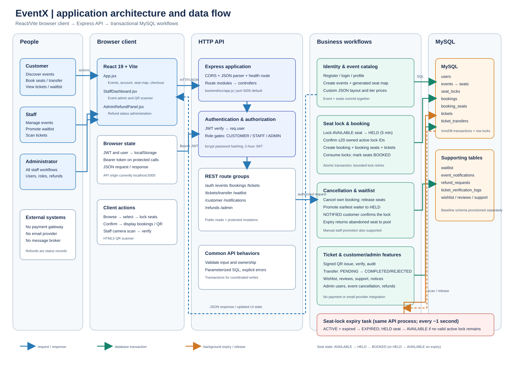

# EventX architecture and workflow

This document describes the application represented by the repository's current source tree. It covers the browser client, Express API, authentication and authorization, MySQL persistence, background seat-lock expiry, and the end-to-end booking and ticket workflows.



## 1. System at a glance

EventX is a browser-based event discovery and ticket-booking application:

1. A React application built with Vite serves the customer experience and staff/admin dashboard.
2. The browser sends JSON over HTTP to an Express API.
3. Express routes apply JWT authentication and role checks before calling controller functions.
4. Controllers use a shared `mysql2/promise` connection pool to read and update MySQL.
5. Multi-row business operations use database transactions so seat, booking, ticket, and transfer state changes commit or roll back together.
6. The API process periodically expires held seats; it runs in the same Node.js process as the HTTP API.

The application currently has no payment processor, email provider, message broker, or separate worker service. Refund records track an administrative/payment status; changing a status does not move money.

## 2. Component and data-flow diagram

The SVG is a standalone vector image so it remains legible when zoomed and can be embedded in GitHub or opened independently.

## 3. Runtime components

### Browser application

- Entry point: `frontend/src/main.jsx`; the React root renders `frontend/src/App.jsx`.
- `App.jsx` implements event discovery, account flows, seat selection, booking, tickets, and customer features.
- `StaffDashboard.jsx` contains staff/admin event and ticket-verification tools.
- `AdminRefundPanel.jsx` provides the administrator refund-status interface.
- `html5-qrcode` supplies the browser camera scanner for staff ticket check-in.
- The client keeps the signed-in user and JWT in browser `localStorage` and sends the JWT as `Authorization: Bearer <token>` on protected requests.
- The API origin is currently hard-coded as `http://localhost:5000/api` in the UI components; change this configuration before hosting the frontend against another API origin.

### HTTP API

- `backend/src/server.js` loads environment configuration, starts the Express listener (port `5000` by default), and schedules seat-lock expiry every second.
- `backend/src/app.js` configures CORS and JSON request parsing, exposes `GET /api/health`, and mounts route modules.
- Route modules map HTTP methods and paths to authentication/role middleware and controller functions.
- `backend/src/middleware/authMiddleware.js` verifies JWTs with `JWT_SECRET` and places decoded claims on `req.user`.
- `backend/src/middleware/authorizeRoles.js` enforces roles such as `CUSTOMER`, `STAFF`, and `ADMIN`.
- Controllers use parameterized SQL through `backend/src/config/db.js`; the MySQL pool is configured from `DB_HOST`, `DB_USER`, `DB_PASSWORD`, and `DB_NAME`.

### Persistence and configuration

MySQL is the source of truth for users, events, seat inventory, active/expired locks, bookings, tickets, waitlists, and supporting customer/admin records. The common booking relationships are:

```text
users ──< bookings ──< booking_seats >── seats >── events
                        │
                        └── tickets

seats ──< seat_locks >── users
events ──< waitlist >── users
tickets ──< ticket_transfers >── users (sender and recipient)
```

Additional feature tables used by the API include `event_notifications`, `refund_requests`, `ticket_verification_logs`, `customer_wishlist`, `event_reviews`, and `customer_support_requests`. Their schema must exist in the configured database. The repository includes the ticket-transfer migration at `backend/migrations/20261122_ticket_transfers.sql`; it does not contain a complete baseline schema migration.

Venue pricing defaults are defined in `backend/src/config/venueConfig.json`. An event may instead supply a validated `venueLayout` object; sample layouts are in `backend/src/config/venues/`.

## 4. Request security and roles

1. Registration validates required fields, normalizes email, hashes the password with bcrypt, and creates a customer account.
2. Login compares the password hash and issues a JWT containing the user ID and role, with a two-hour expiry.
3. The browser attaches the bearer token to protected API requests.
4. Authentication verifies the token; role middleware then allows or rejects the requested operation.
5. Database access uses bound SQL parameters. Booking, seat-lock, ticket, cancellation, refund, and transfer transitions use transactions where coordinated state changes are required.

Typical access boundaries:

| Capability | Access |
|---|---|
| Browse published events and read event seats/reviews | Public |
| Register and sign in | Public |
| Lock seats, confirm/cancel own bookings, manage own account and customer features | Customer |
| Create/update events, manage events, promote a waitlisted customer, verify tickets | Staff or admin (route-specific) |
| List users, change roles, process refund-status transitions | Admin |
| Initiate/accept/reject a ticket transfer | Authenticated sender, intended recipient, or sender/recipient as appropriate |

Authorization is enforced by API middleware, not merely by hiding UI controls.

## 5. Main workflows

### 5.1 Event creation and publication

1. A staff/admin client submits event details and optionally `venueLayout`.
2. The API validates required fields, row/seat limits, section coverage, and positive prices. If no custom layout is supplied, it derives the layout from `venueConfig.json`.
3. The event and generated seats (including section and price) are inserted in one database transaction.
4. Public event discovery returns published events; staff/admin management can list and update event lifecycle details.

### 5.2 Seat selection and booking

1. The client loads the event's seat inventory and displays each seat's status, section, and price.
2. A customer locks an available seat through `POST /api/events/:eventId/seats/:seatId/lock`.
3. The API starts a transaction, locks the event and seat rows, verifies the event is published and the seat is available, creates an `ACTIVE` seat lock with a five-minute expiry, marks the seat `HELD`, and commits. Competing attempts for the same seat serialize on its database row.
4. The client may lock multiple seats and submits their lock IDs to `POST /api/bookings/confirm` (up to 20 seats per booking).
5. The API validates lock ownership, state, expiry, and event status. In a single transaction it creates one confirmed booking, its booking-seat records and tickets, changes seats from `HELD` to `BOOKED`, and consumes the locks.
6. If validation or a write fails, the transaction rolls back. Transient MySQL deadlock/lock-timeout errors are retried a bounded number of times.
7. The API returns booking details and ticket data; the client refreshes seat availability and the customer's booking/ticket views.

### 5.3 Lock expiry and seat release

- A lock is valid for five minutes.
- The API's periodic expiry task finds expired `ACTIVE` locks, changes them to `EXPIRED`, and changes a `HELD` seat back to `AVAILABLE` only when no valid active lock remains.
- Seat-lock requests and booking confirmation also validate expiry, so stale locks cannot be used merely because the periodic task has not yet run.
- A waitlist promotion uses the same five-minute lock mechanism.

### 5.4 Booking cancellation and waitlist promotion

1. A customer may cancel only their own confirmed booking.
2. In a transaction, the API locks the booking and its booked seats, cancels eligible tickets (also rejecting any pending transfers), releases the seats, and marks the booking `CANCELLED`.
3. For released seats, the API selects up to the same number of earliest `WAITING` customers. It creates a five-minute active seat lock for each promoted customer, changes each reserved seat to `HELD`, and moves each waitlist entry to `NOTIFIED` before committing.
4. A promoted customer confirms the issued lock through the normal booking endpoint. If the lock expires, the expiry process releases that held seat.
5. Separately, staff/admin can call the waitlist promotion endpoint to reserve an available seat for the next waiter.
6. Customers can join only a published event with no available seats; waitlist positions are assigned in order.

### 5.5 Ticket issue, QR check-in, and audit

1. Booking confirmation creates one ticket per booking seat. The ticket record contains a unique code, nonce, and status.
2. QR data encodes `eventId|seatId|ticketId|nonce` plus an HMAC-SHA256 signature made with `TICKET_HMAC_SECRET`; the API returns a QR image to the client.
3. Staff/admin scans the QR or submits it to the verification endpoint.
4. The API verifies the signature and its database values, requires the ticket to be `VALID`, and changes it to `USED` transactionally so repeat scans are rejected.
5. Verification middleware records the outcome and a SHA-256 fingerprint of the QR payload in `ticket_verification_logs`; it does not store the raw QR payload.

### 5.6 Two-party ticket transfer

1. An authenticated ticket owner names an existing recipient by email. In one transaction the API verifies ownership and ticket/booking status, changes the ticket from `VALID` to `PENDING_TRANSFER`, and creates a `PENDING` transfer record.
2. Only the intended recipient can accept. The API locks the transfer and ticket rows, creates a confirmed booking for the recipient, reassigns the booking-seat row, restores the ticket to `VALID`, marks the transfer `COMPLETED`, and commits atomically.
3. Either sender or recipient may reject a pending transfer. The ticket returns to `VALID` for the sender and the transfer becomes `REJECTED`.
4. Row locks and transaction status checks serialize accept/reject races. Cancellation of the source booking/event also cancels the ticket and resolves the pending transfer.

### 5.7 Supporting customer and admin workflows

- Customers can manage profiles/passwords, wishlists, reviews for eligible completed events, support requests, waitlists, and notifications.
- Event cancellation cancels confirmed bookings/tickets, releases inventory, creates customer notifications and refund-request records transactionally.
- Admins can transition refund requests through the configured status flow. This is status tracking only; no payment gateway is connected.
- Staff/admin users can view verification history and manage events. Admin-only operations include user listing/role changes and refund decisions.

## 6. API route map

All paths are relative to the API origin.

| Prefix | Main responsibility | Typical protection |
|---|---|---|
| `/api/health` | Process health response | Public |
| `/api/auth` | Register, login, current profile, password change | Mix of public/authenticated |
| `/api/events` | Published event listing, seat inventory, staff event management | Public reads; staff/admin writes |
| `/api/events/:eventId/seats/:seatId/lock` | Temporary seat reservation | Customer |
| `/api/bookings` | Confirm, list own bookings, cancel | Customer |
| `/api/tickets` | List/create tickets, verify QR, verification history | Authenticated; verification staff/admin |
| `/api/tickets/transfer` | Initiate, accept, reject transfer | Authenticated; ownership checked in controller |
| `/api/waitlist` | Join/list/leave and staff promotion | Customer or staff/admin |
| `/api/customer` | Wishlist, reviews, support | Mix of public reviews and customer actions |
| `/api/notifications` | List and mark own notifications read | Customer |
| `/api/refunds` | List/update refund requests | Admin |
| `/api/admin` | User lookup and role changes | Admin |

## 7. Repository map

```text
frontend/
  src/main.jsx                 React entry point
  src/App.jsx                  Customer application and event/booking workflows
  src/StaffDashboard.jsx       Staff/admin workflows and QR check-in
  src/AdminRefundPanel.jsx     Refund review UI
backend/
  src/server.js                HTTP server and seat-lock expiry scheduling
  src/app.js                   Express setup and route mounting
  src/routes/                  HTTP routes and middleware composition
  src/controllers/             Business workflows and SQL transactions
  src/middleware/              JWT roles and ticket-verification audit
  src/config/db.js             MySQL connection pool
  src/config/venueConfig.json  Default seat map and tier pricing
  src/config/venues/           Sample custom venue definitions
  src/utils/                   Venue validation and seat-lock expiry
  migrations/                  Incremental schema migration(s)
```

## 8. Local runtime and configuration

- Backend: configure `backend/.env` with `DB_HOST`, `DB_USER`, `DB_PASSWORD`, `DB_NAME`, `JWT_SECRET`, and `TICKET_HMAC_SECRET`; install dependencies and run `npm run dev` from `backend/`.
- Frontend: install dependencies and run `npm run dev` from `frontend/`; Vite serves the development client on its configured default port.
- MySQL: provision the baseline EventX schema before starting the API, and apply `backend/migrations/20261122_ticket_transfers.sql` for ticket transfers.
- The backend defaults to port `5000`. The frontend API URL is currently hard-coded to this local origin.
- `GET /api/health` confirms that the HTTP process responds; it is not a database-readiness check.

No production hosting topology, reverse proxy, TLS termination, secrets manager, database migration runner, or API/frontend environment-based origin configuration is included in this repository.
